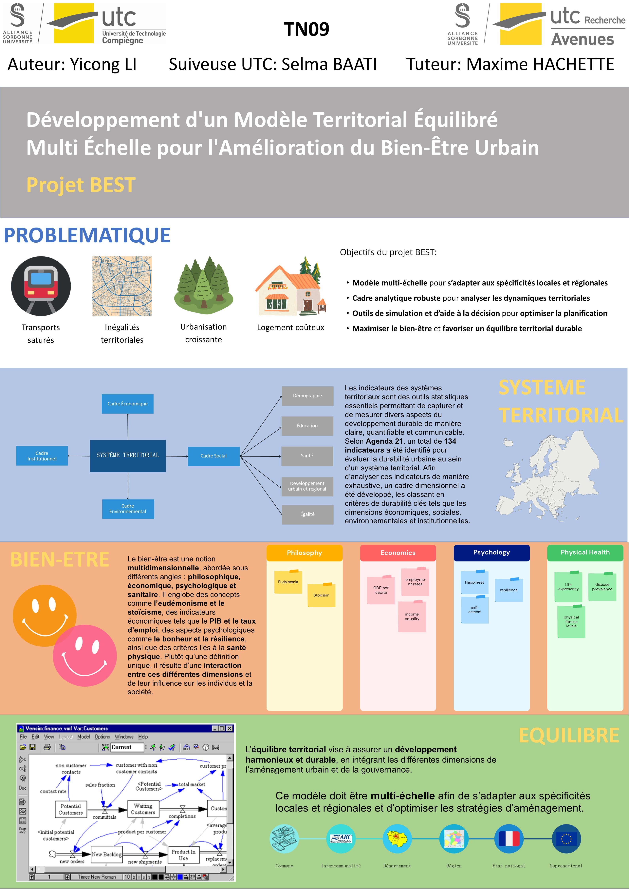

# Projet BEST — Modèle territorial équilibré multi-échelle et bien-être urbain

**Stage de fin d'études (UV TN09) — Université de Technologie de Compiègne**
Laboratoire **Avenues** (EA 7284, département Génie Urbain) · Compiègne, France
**2 septembre 2024 – 14 février 2025** (6 mois) · **Yicong LI**
Tuteur : Maxime Hachette (MCF) · Suiveuse UTC : Selma Baati

*Trois revues systématiques de la littérature (PRISMA), un référentiel d'indicateurs
territoriaux et de bien-être, et une analyse exploratoire des corrélations sous Python —
au service d'un modèle conceptuel d'« équilibre territorial dynamique ».*



---

## Le projet BEST

**BEST** (*Bâtir un socle théorique pour la notion d'Équilibre du Système Territorial*)
est un projet de recherche de l'UTC, financé par la Direction à la recherche dans le
cadre de l'Appel Jeunes Maîtres de Conférences.

Les territoires en croissance cumulent transports saturés, inégalités territoriales,
urbanisation rapide et coût du logement élevé. Le projet vise un cadre analytique
multi-échelle capable d'articuler logement, transports, environnement et économie, pour
évaluer puis simuler l'**équilibre territorial** en mettant le **bien-être des occupants**
au centre de la décision publique.

### Ma mission

| Axe | Contenu |
| --- | --- |
| **Revues de littérature** | Trois revues systématiques : système territorial, bien-être, équilibre |
| **Indicateurs** | Référentiels d'indicateurs (définition, source, méthode de calcul) pour le territoire et le bien-être |
| **Analyse de données** | Exploration des corrélations entre indicateurs (Python / Jupyter) |
| **Modélisation** | Contribution au modèle conceptuel et à l'algorithme d'aide à la décision |

---

## Démarche

### 1. Revue systématique selon PRISMA

Recherche sur **Scopus, Google Scholar, HAL et PROSPERO**, gestion bibliographique sous
**Zotero**, sélection en quatre étapes (identification → suppression des doublons →
tri sur titres et résumés → lecture intégrale).

| Thème | Articles analysés | Question directrice |
| --- | --- | --- |
| Système territorial | 360 | Comment un territoire s'organise-t-il, et à quelles échelles ? |
| Bien-être | 120 | Quelles dimensions composent le bien-être des occupants ? |
| Équilibre territorial | 80 | Quels leviers permettent un développement harmonieux ? |
| **Total** | **560** | |

### 2. Construction du référentiel d'indicateurs

- **Système territorial** : 134 indicateurs issus du cadre Agenda 21, classés selon un
  cadre dimensionnel (économique, social, environnemental, institutionnel).
- **Bien-être** : les 11 dimensions du *Better Life Index* de l'OCDE (logement, revenu,
  emploi, communauté, éducation, environnement, engagement civique, santé, satisfaction
  de vie, sécurité, équilibre vie professionnelle/personnelle), en distinguant
  indicateurs **objectifs** et **subjectifs**.

### 3. Analyse exploratoire des corrélations

Croisement des 22 indicateurs OCDE (`pandas` → pivot pays × indicateurs → matrice de
Pearson → cartes thermiques `seaborn`).


- Espérance de vie ↔ logements sans équipements de base : **r ≈ −0,85**
- Revenus personnels ↔ satisfaction de vie : **r ≈ +0,80**
- Taux de chômage ↔ niveau de compétences : **r ≈ −0,68**

### 4. Modèle conceptuel et perspectives

Mobilisation de la *Dynamique Urbaine* de Forrester (1969), de l'analyse multicritère
(MCDA) et des cadres PSR / DPSIR, avec **Vensim** (simulation dynamique) et **ArcGIS**
(analyse spatiale), pour relier sous-systèmes, indicateurs et boucles de rétroaction.

---

## Contenu du dépôt

| Dossier | Contenu |
| --- | --- |
| [`01-rapport/`](01-rapport) | Rapport de stage (PDF) et source éditable |
| [`02-soutenance/`](02-soutenance) | Diaporama de soutenance et texte du discours |
| [`03-poster/`](03-poster) | Poster scientifique (PDF, PPTX, JPG) |
| [`04-revues-litterature/`](04-revues-litterature) | Les trois revues systématiques complètes |
| [`05-indicateurs/`](05-indicateurs) | Tableaux d'indicateurs et [analyse des corrélations](05-indicateurs/analyse-correlations) (code + données + figures) |
| [`06-bibliographie/`](06-bibliographie/references.md) | Corpus documentaire des revues |
| [`07-transmission/`](07-transmission) | Support de passation laissé à l'équipe suivante |

### Reproduire l'analyse

```bash
cd 05-indicateurs/analyse-correlations
pip install -r requirements.txt
python analyse_correlations.py
```

---

## Outils

`Python` · `pandas` · `matplotlib` · `seaborn` · `Jupyter/Colab` · `Zotero` ·
`Vensim` · `ArcGIS` · `Excel` · `LimeSurvey` (équipe) · `Scopus` / `Google Scholar` / `HAL`

---

## Confidentialité et droits

Une partie des fichiers du stage ne peut pas être publiée : données personnelles,
évaluation de stage, travaux d'autres membres de l'équipe, articles scientifiques sous
droits d'auteur. Ils ont été regroupés dans un dossier `archive/` **exclu du dépôt**
(`.gitignore`) et restent disponibles localement.

Le travail d'enquête du projet BEST (questionnaires, entretiens, atelier étudiant) a été
mené par **Justine Lamine** dans le cadre de son propre stage ; les documents
correspondants ne sont pas diffusés ici.

> Contenu personnel — merci de me contacter avant toute réutilisation.

---

## English summary

Six-month internship at the **Avenues research lab** (UTC, Compiègne) on the **BEST**
project: building a theoretical framework for the notion of *territorial system balance*.
I conducted three PRISMA systematic literature reviews (560 papers: territorial systems,
well-being, territorial balance), built indicator frameworks (Agenda 21's 134 urban
sustainability indicators; the OECD Better Life Index's 11 dimensions), and ran an
exploratory correlation analysis of 22 OECD indicators in Python. Deliverables include the
internship report, defence slides and a scientific poster — all in `01-` to `05-` folders.

## 中文摘要

在法国贡比涅技术大学（UTC）**Avenues 实验室**完成六个月研究实习，参与 **BEST** 项目
（"构建领土系统均衡概念的理论基础"）。工作包括：三份基于 **PRISMA** 的系统性文献综述
（共 560 篇：领土系统、福祉、领土均衡）；构建领土与福祉**指标体系**（Agenda 21 的 134 项
可持续指标、OECD Better Life Index 的 11 个维度）；用 Python 对 22 项指标做**相关性分析**
并绘制热力图。仓库中包含实习报告、答辩幻灯片、学术海报、三份综述全文及可复现代码。
