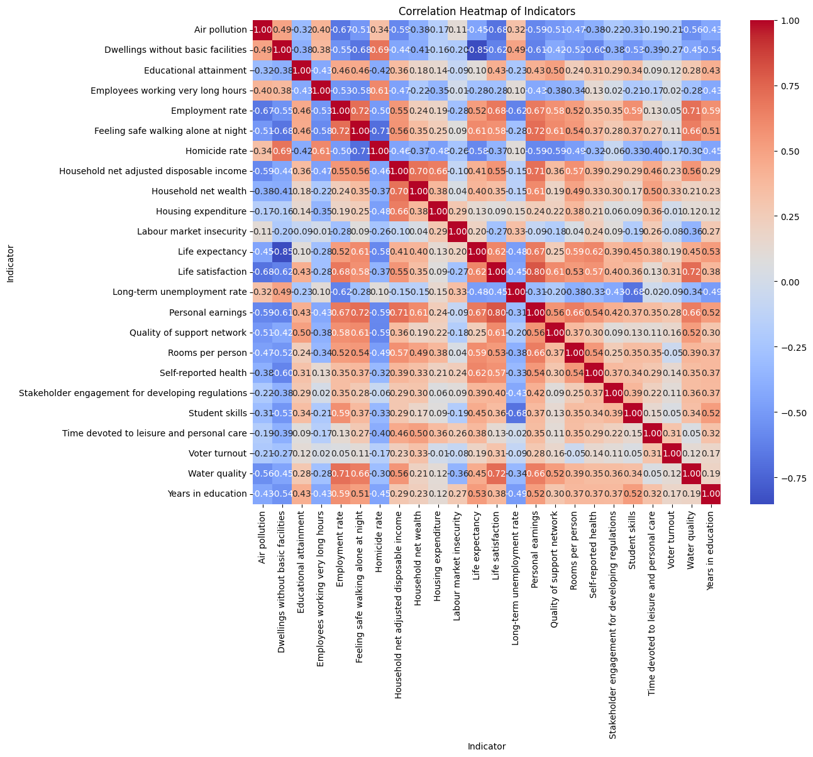

# Projet BEST — Modèle territorial équilibré multi-échelle et bien-être urbain

**Stage de fin d'études (UV TN09)** · Université de Technologie de Compiègne (UTC)
Laboratoire **Avenues** — EA 7284, département Génie Urbain · Compiègne, France
**2 septembre 2024 – 14 février 2025** (6 mois) · **Yicong LI**
Tuteur : Maxime Hachette (MCF) · Suiveuse UTC : Selma Baati

**[Français](#fr) · [中文](#zh)**

---

<a id="fr"></a>

## Français

### En bref

| | |
| --- | --- |
| **Structure d'accueil** | Laboratoire Avenues (EA 7284), UTC — département Génie Urbain |
| **Cadre** | UV TN09 — stage de fin d'études, 6 mois |
| **Projet** | BEST — *Bâtir un socle théorique pour la notion d'Équilibre du Système Territorial* |
| **Rôle** | Revue de littérature, référentiels d'indicateurs, analyse de données, modélisation conceptuelle |
| **Livrables** | 3 revues systématiques · 2 référentiels d'indicateurs · 1 analyse reproductible · rapport, soutenance, poster |

### Le projet BEST

Les territoires en croissance cumulent quatre tensions : **transports saturés**,
**inégalités territoriales**, **urbanisation rapide** et **coût du logement élevé**.
Les modèles existants (dynamique urbaine, MCDA, PSR/DPSIR) traitent séparément logement,
mobilité, environnement et économie, et aucun ne propose de représentation unifiée du
système territorial.

Le projet BEST, financé par la Direction à la recherche de l'UTC dans le cadre de l'Appel
Jeunes Maîtres de Conférences, vise donc à :

- construire un **cadre théorique** de la notion d'« équilibre » appliquée aux systèmes territoriaux ;
- caractériser un **équilibre territorial dynamique**, multi-échelle, dont le critère final
  est le **bien-être des occupants** ;
- préparer un **outil d'aide à la décision** (représentation multiscalaire, évaluation
  continue, simulation) destiné aux aménageurs et aux élus.

### Ma mission

Trois revues de littérature indépendantes, un travail d'opérationnalisation des concepts
en indicateurs, et une exploration quantitative des liens entre ces indicateurs.

| Axe | Ce que j'ai fait |
| --- | --- |
| **Revues systématiques** | Trois revues PRISMA (système territorial, bien-être, équilibre) : protocole, équations de recherche, sélection, grille de pertinence, synthèse |
| **Indicateurs** | Construction de deux référentiels : définition, source officielle et méthode de calcul pour chaque indicateur |
| **Analyse de données** | Nettoyage, mise en forme et corrélation de 22 indicateurs OCDE ; cartes thermiques et comparaison par groupe de pays |
| **Modélisation** | Contribution au modèle conceptuel et à l'algorithme d'aide à la décision du projet |

### Chronologie

| Période | Travail |
| --- | --- |
| 02/09 – 31/10/2024 | Revue de littérature — **système territorial** |
| 16/09 – 11/10/2024 | Appui à la conception et à l'analyse du **questionnaire bien-être** de l'équipe |
| 14/10 – 31/10/2024 | Étude des modèles de **dynamique urbaine** |
| 01/11 – 21/12/2024 | Revue de littérature — **bien-être** |
| 01/12 – 21/12/2024 | **Indicateurs** : méthodes de calcul, sources, corrélations |
| 06/01 – 14/02/2025 | Revue de littérature — **équilibre territorial**, rédaction et soutenance |

### Méthodologie

#### 1. Revue systématique selon PRISMA

Recherche sur **Scopus, Google Scholar, HAL et PROSPERO**, corpus limité en priorité aux
dix dernières années, en français et en anglais. Gestion bibliographique sous **Zotero**
(citations, annotations, suivi des références croisées).

Le protocole suit quatre étapes : identification des études → suppression des doublons →
tri sur titres et résumés → lecture intégrale et application de la grille d'inclusion.
Chaque article est classé **pertinent / partiellement pertinent / non pertinent** avec
justification.

| Thème | Articles analysés | Question directrice |
| --- | --- | --- |
| Système territorial | 360 | Comment un territoire s'organise-t-il, et à quelles échelles ? |
| Bien-être | 120 | Quelles dimensions composent le bien-être des occupants ? |
| Équilibre territorial | 80 | Quels leviers permettent un développement harmonieux ? |
| **Total** | **560** | |

#### 2. Référentiel d'indicateurs

- **Système territorial** : les 134 indicateurs de durabilité urbaine du cadre Agenda 21,
  classés selon un cadre dimensionnel (économique, social, environnemental, institutionnel),
  puis complétés par des indicateurs opérationnels issus de sources françaises (INSEE,
  ADEME, eaufrance, ATMO France, ministères).
- **Bien-être** : les 11 dimensions du *Better Life Index* de l'OCDE — logement, revenu,
  emploi, communauté, éducation, environnement, engagement civique, santé, satisfaction de
  vie, sécurité, équilibre vie professionnelle / vie personnelle — avec la distinction
  entre indicateurs **objectifs** (taux d'homicides) et **subjectifs** (sentiment de
  sécurité en marchant seul la nuit).

Chaque ligne des deux classeurs documente la **définition**, la **source** et la **formule
de calcul**, pour rendre les indicateurs directement implémentables.

#### 3. Analyse exploratoire des corrélations

Objectif : vérifier la cohérence interne du jeu d'indicateurs et repérer les
interdépendances à intégrer dans le modèle.

```
CSV OCDE (format long)  →  pivot pays × indicateurs  →  matrice de Pearson
                        →  cartes thermiques (seaborn)  →  comparaison par groupe de pays
```



| Relation observée | r | Lecture |
| --- | --- | --- |
| Espérance de vie ↔ logements sans équipements de base | **−0,85** | Le défaut d'installations sanitaires dégrade l'hygiène, donc l'état sanitaire |
| Revenus personnels ↔ satisfaction de vie | **+0,80** | Le bien-être perçu est fortement lié à la stabilité financière |
| Taux de chômage ↔ niveau de compétences | **−0,68** | Lien entre qualification et employabilité |

Une anomalie est conservée telle quelle : la **qualité de l'eau** ressort fortement
corrélée au taux d'emploi et à la satisfaction de vie — probable effet de structure de
l'échantillon, à approfondir.

#### 4. Modélisation conceptuelle

Mobilisation de la **Dynamique Urbaine** de Forrester (1969) — trois sous-systèmes
population / logement / activité économique et boucles de rétroaction —, de l'**analyse
multicritère (MCDA)** pour l'évaluation des choix d'aménagement, des cadres **PSR** et
**DPSIR**, et du **modèle de sensibilité** pour les interactions systémiques.

Outils : **Vensim** (simulation dynamique), **ArcGIS** (analyse spatiale et
cartographie), **Python** (traitement des indicateurs), **Excel** (référentiels).

### Contributions et résultats

1. **Un corpus structuré de 560 articles** et trois synthèses conceptuelles qui définissent
   le système territorial, le bien-être et l'équilibre, et explicitent leurs liens.
2. **Deux référentiels d'indicateurs prêts à l'emploi**, avec sources officielles et
   formules, qui constituent la base quantitative du futur outil.
3. **Une analyse reproductible** (code, données, figures) montrant que la majorité des
   corrélations du *Better Life Index* sont cohérentes avec le sens commun — ce qui
   valide le choix des indicateurs — et isolant les cas atypiques.
4. **Une contribution au cadre conceptuel** et à l'algorithme d'aide à la décision
   applicables aux systèmes urbains.

### Limites et recul critique

- Corpus majoritairement **anglophone** ; la littérature francophone a été exploitée de
  façon complémentaire, pas systématique.
- **Corrélation n'est pas causalité** : l'analyse est exploratoire, sans test de
  significativité ni contrôle des variables confondantes.
- Les valeurs manquantes sont remplacées par `0` (choix de l'analyse d'origine), ce qui
  peut biaiser certaines corrélations pour les pays incomplets.
- Les indicateurs restent **hétérogènes** (échelles, unités, périodes) : leur agrégation
  en un indice unique n'était pas l'objet de ce stage.

### Contenu du dépôt

| Dossier | Contenu |
| --- | --- |
| [`01-rapport/`](01-rapport) | Rapport de stage (35 p.) et source éditable |
| [`02-soutenance/`](02-soutenance) | Diaporama de soutenance et texte du discours |
| [`03-poster/`](03-poster) | Poster scientifique (PDF, PPTX, JPG) |
| [`04-revues-litterature/`](04-revues-litterature) | Les trois revues systématiques complètes |
| [`05-indicateurs/`](05-indicateurs) | Référentiels d'indicateurs et [analyse des corrélations](05-indicateurs/analyse-correlations) (code, données, figures) |
| [`06-bibliographie/`](06-bibliographie/references.md) | Corpus documentaire des revues |
| [`07-transmission/`](07-transmission) | Support de passation laissé à l'équipe suivante |

### Reproduire l'analyse

```bash
cd 05-indicateurs/analyse-correlations
pip install -r requirements.txt
python analyse_correlations.py
```

Le script lit `data/OECD_BLI_all.csv` et régénère les trois cartes thermiques dans
`figures/`. Le notebook d'origine est conservé dans `notebook/`, avec ses sorties.

### Outils et compétences

`Python` · `pandas` · `matplotlib` · `seaborn` · `Jupyter / Colab` · `Zotero` ·
`Vensim` · `ArcGIS` · `Excel` · `LimeSurvey` (équipe) · `Scopus` / `Google Scholar` / `HAL`

Revue systématique · analyse de données · modélisation systémique · rédaction et
communication scientifique en français · gestion de projet en autonomie.

### Confidentialité et droits

Une partie des fichiers du stage ne peut pas être publiée : données personnelles,
évaluation de stage, travaux d'autres membres de l'équipe, articles scientifiques sous
droits d'auteur. Ils sont regroupés dans un dossier `archive/` **exclu du dépôt**
(`.gitignore`) et restent disponibles localement.

Le volet enquête du projet BEST (questionnaires, entretiens, atelier étudiant) a été mené
par **Justine Lamine** dans le cadre de son propre stage ; les documents correspondants ne
sont pas diffusés ici.

© Yicong LI — contenu personnel, merci de me contacter avant toute réutilisation.

---

<a id="zh"></a>

## 中文

### 概要

| | |
| --- | --- |
| **实习单位** | 法国贡比涅技术大学（UTC）Avenues 实验室（EA 7284），城市工程系 |
| **课程背景** | UV TN09 毕业实习，为期 6 个月 |
| **所属项目** | BEST——"为领土系统均衡概念构建理论基础" |
| **我的角色** | 文献综述、指标体系构建、数据分析、概念建模 |
| **交付成果** | 3 份系统性综述 · 2 套指标体系 · 1 份可复现分析 · 报告、答辩、海报 |

### 项目背景

快速发展的城市地区普遍面临四重压力：**交通饱和**、**领土不平等**、**城市化过快**、
**住房成本高企**。现有模型（城市动力学、多准则决策 MCDA、PSR/DPSIR 框架）通常把住房、
交通、环境与经济割裂处理，尚无对领土系统的统一表征。

BEST 项目由 UTC 科研处"青年教研人员基金"资助，目标是：

- 为领土系统中的**"均衡"**概念建立理论框架；
- 刻画一种**动态的、多尺度的领土均衡**，其最终判据是**居民福祉**；
- 为规划师与决策者准备一套**辅助决策工具**（多尺度表征、持续评估、情景模拟）。

### 我的工作

独立完成三份文献综述，把概念落实为可计算的指标，并对指标之间的关系做定量探索。

| 方向 | 具体工作 |
| --- | --- |
| **系统性综述** | 三份 PRISMA 综述（领土系统、福祉、均衡）：协议、检索式、筛选、相关性评分表、综合归纳 |
| **指标体系** | 建立两套指标表：每项指标的定义、官方数据来源、计算方法 |
| **数据分析** | 清洗与重构 22 项 OECD 指标，计算相关性，绘制热力图并按国家组比较 |
| **建模** | 参与项目概念模型与辅助决策算法的构建 |

### 时间线

| 时间 | 工作 |
| --- | --- |
| 2024.09.02 – 10.31 | 文献综述：**领土系统** |
| 2024.09.16 – 10.11 | 协助团队设计并分析**福祉问卷** |
| 2024.10.14 – 10.31 | **城市动力学**模型研究 |
| 2024.11.01 – 12.21 | 文献综述：**福祉** |
| 2024.12.01 – 12.21 | **指标研究**：计算方法、数据来源、相关性 |
| 2025.01.06 – 02.14 | 文献综述：**领土均衡**，撰写报告与答辩 |

### 方法

#### 1. 基于 PRISMA 的系统性文献综述

在 **Scopus、Google Scholar、HAL、PROSPERO** 检索，以近十年、法英双语文献为主，
使用 **Zotero** 管理文献、标注与引文追踪。

流程分四步：识别研究 → 去除重复 → 题名摘要初筛 → 全文精读并按纳入标准筛选。
每篇文章按**相关 / 部分相关 / 不相关**三档评级并注明理由。

| 主题 | 分析文献量 | 核心问题 |
| --- | --- | --- |
| 领土系统 | 360 | 领土如何组织？存在哪些尺度？ |
| 福祉 | 120 | 居民福祉由哪些维度构成？ |
| 领土均衡 | 80 | 哪些杠杆能带来协调发展？ |
| **合计** | **560** | |

#### 2. 指标体系

- **领土系统**：Agenda 21 的 134 项城市可持续指标，按经济、社会、环境、制度四个
  维度归类，并补充法国官方来源（INSEE、ADEME、eaufrance、ATMO France、各部委）的
  可操作指标。
- **福祉**：OECD *Better Life Index* 的 11 个维度——住房、收入、就业、社区、教育、
  环境、公民参与、健康、生活满意度、安全、工作与生活平衡，并区分**客观指标**
  （如凶杀率）与**主观指标**（如夜间独行安全感）。

两套表格的每一行都记录了**定义、数据来源与计算公式**，使指标可以直接落地实现。

#### 3. 相关性探索分析

目的：检验指标集内部的一致性，并找出建模时需要纳入的相互依赖关系。

```
OECD 长表 CSV  →  透视（国家 × 指标）  →  Pearson 相关矩阵
              →  热力图（seaborn）      →  按国家组对比
```


| 观察到的关系 | r | 解读 |
| --- | --- | --- |
| 预期寿命 ↔ 缺乏基本设施的住房 | **−0,85** | 卫生设施缺失导致卫生条件恶化，进而影响健康 |
| 个人收入 ↔ 生活满意度 | **+0,80** | 主观福祉与财务稳定性高度相关 |
| 失业率 ↔ 技能水平 | **−0,68** | 资历与就业能力之间的关系 |

同时保留了一处反常结果：**水质**与就业率、生活满意度高度相关，可能是样本的结构性
效应，有待进一步检验。

#### 4. 概念建模

采用 Forrester（1969）的**城市动力学**——人口、住房、经济活动三个子系统及反馈回路；
结合**多准则决策分析（MCDA）**评估规划方案，参考 **PSR / DPSIR** 框架与**敏感性模型**
处理系统交互。

工具：**Vensim**（系统动力学仿真）、**ArcGIS**（空间分析与制图）、**Python**（指标
处理）、**Excel**（指标表）。

### 成果

1. **560 篇文献的结构化语料库**与三份概念综述，界定了领土系统、福祉与均衡，并厘清
   三者关系。
2. **两套可直接使用的指标体系**，含官方来源与计算公式，构成未来工具的定量基础。
3. **一份可复现的分析**（代码、数据、图表）：证明 *Better Life Index* 的多数相关性与
   常识一致——这为指标选择提供了一定的效度支持——并单独标出了异常项。
4. **对概念框架与辅助决策算法的贡献**，可应用于城市系统。

### 局限与反思

- 语料以**英文文献**为主，法语文献是补充性使用，而非系统性覆盖。
- **相关不等于因果**：分析属探索性质，未做显著性检验，也未控制混杂变量。
- 缺失值以 `0` 填补（沿用原始分析的做法），可能使部分国家的相关系数产生偏差。
- 指标在**尺度、单位、时间口径**上并不统一，汇总为单一指数不在本次实习范围内。

### 仓库结构

| 目录 | 内容 |
| --- | --- |
| [`01-rapport/`](01-rapport) | 实习报告（35 页）及可编辑源文件 |
| [`02-soutenance/`](02-soutenance) | 答辩幻灯片与讲稿 |
| [`03-poster/`](03-poster) | 学术海报（PDF、PPTX、JPG） |
| [`04-revues-litterature/`](04-revues-litterature) | 三份系统性综述全文 |
| [`05-indicateurs/`](05-indicateurs) | 指标表与[相关性分析](05-indicateurs/analyse-correlations)（代码、数据、图表） |
| [`06-bibliographie/`](06-bibliographie/references.md) | 综述参考文献清单 |
| [`07-transmission/`](07-transmission) | 留给下一任实习生的交接材料 |

### 复现分析

```bash
cd 05-indicateurs/analyse-correlations
pip install -r requirements.txt
python analyse_correlations.py
```

脚本读取 `data/OECD_BLI_all.csv`，重新生成 `figures/` 下的三张热力图。原始 notebook
保存在 `notebook/` 中，保留了运行输出。

### 工具与能力

`Python` · `pandas` · `matplotlib` · `seaborn` · `Jupyter / Colab` · `Zotero` ·
`Vensim` · `ArcGIS` · `Excel` · `LimeSurvey`（团队） · `Scopus` / `Google Scholar` / `HAL`

系统性文献综述 · 数据分析 · 系统建模 · 法语学术写作与口头汇报 · 独立推进项目。

### 隐私与版权

部分文件不宜公开：个人资料、实习评价、团队其他成员的工作成果、受版权保护的期刊论文。
它们已集中放入 `archive/` 目录，并通过 `.gitignore` **排除在仓库之外**，仅保留在本地。

BEST 项目的调研部分（问卷、访谈、学生工作坊）由 **Justine Lamine** 在其本人实习期间
完成，相关文档不在本仓库中发布。

© Yicong LI — 个人作品，转载或复用前请先与我联系。
